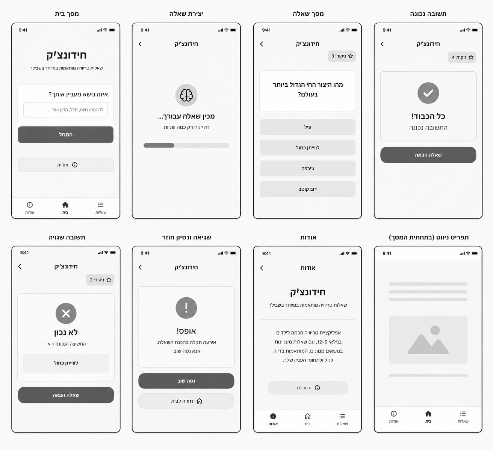
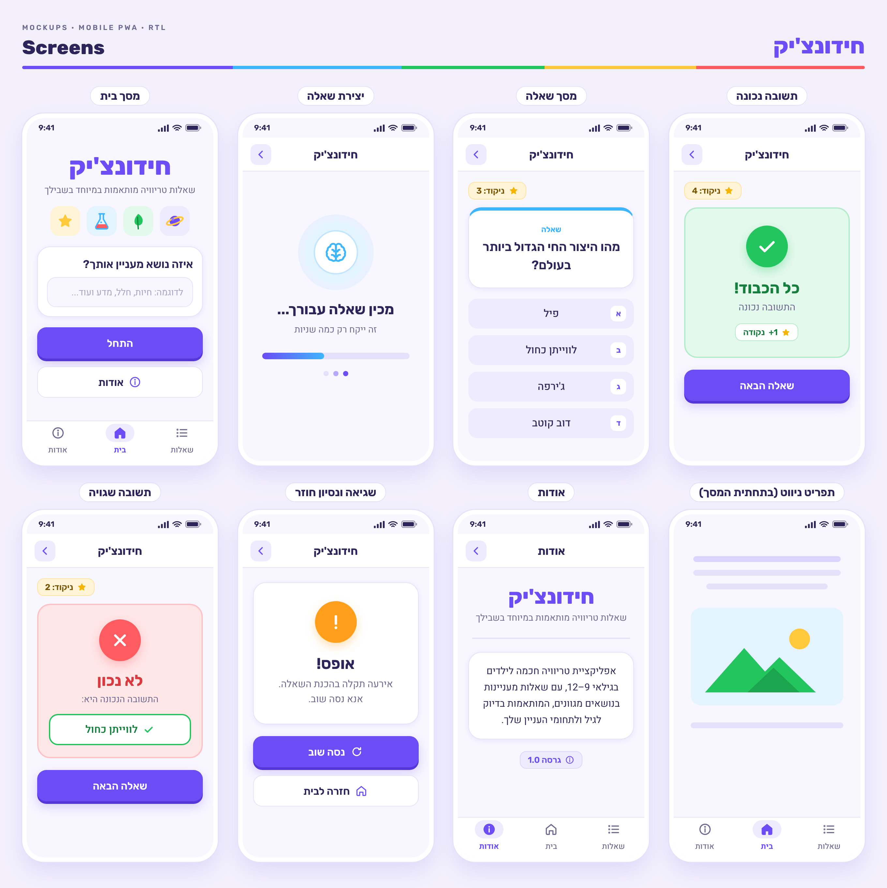
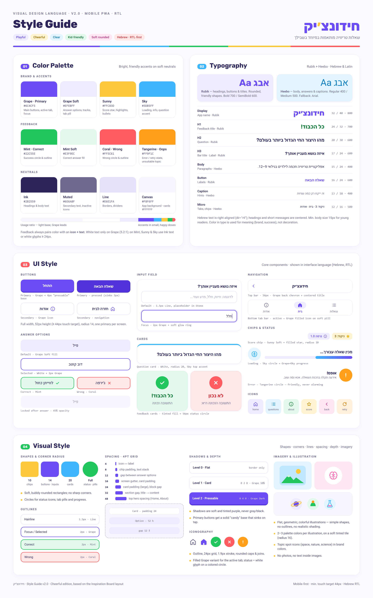

# DESIGN — חידונצ'יק

מסמך זה מתאר את העיצוב של האפליקציה: מבנה המסכים, הניווט ביניהם והשפה החזותית. דרישות המוצר והתנהגות המערכת מתועדות ב־`PRD.md` ואינן חוזרות כאן.

**מקורות:**

| מקור | משמש עבור |
|---|---|
| `PRD.md` | דרישות, התנהגות מסכים ואילוצי UX |
| `wireframes.png` | מבנה המסכים, פריסה ורכיבי UI |
| `style-guide.png` | צבעים, טיפוגרפיה וסגנון רכיבים |
| `mockups.png` | המראה החזותי הסופי של המסכים |

**כלל הכרעה:** כאשר יש סתירה, המבנה והתוכן נלקחים מה־Wireframes, והשפה העיצובית (צבעים, גדלים, סגנון) נלקחת מה־Style Guide.

---

## 1. Screens — מסכי האפליקציה

### Wireframes



### Mockups



### רכיבים משותפים לכל המסכים

- **Top bar:** גובה 56px, רקע לבן וקו תחתון דק בצבע Line. כותרת ממורכזת (`חידונצ'יק`, או `אודות` במסך אודות). בצד שמאל כפתור חזרה עם חץ (chevron) בצבע Grape, על משטח Grape Soft מעוגל. מופיע בכל המסכים מלבד מסך הבית.
- **Score chip:** תווית `ניקוד: N` עם כוכב מלא, ברקע Sunny Soft ובפינות radius 10. ממוקמת מתחת ל־Top bar, בצד שמאל. מופיעה במסך השאלה ובמסכי המשוב.
- **Bottom tab bar:** שלוש לשוניות, משמאל לימין: `אודות`, `בית`, `שאלות`. מופיעה במסך הבית ובמסך אודות (וכך גם במסך "תפריט ניווט" ב־Wireframes, שמציג את הרכיב עצמו).
- **Status bar:** שורת המערכת של הטלפון (שעה, קליטה, סוללה). זהו חלק מתצוגת המכשיר ולא רכיב של האפליקציה.

---

### 1.1 מסך בית

**מטרת המסך:** להציג את האפליקציה, לאפשר הזנת נושא ולהתחיל חידון.

**מבנה ותוכן (מלמעלה למטה):**
1. שם האפליקציה `חידונצ'יק`: סגנון Display, בצבע Grape, ממורכז.
2. כותרת משנה: `שאלות טריוויה מותאמות במיוחד בשבילכם`, בצבע Muted.
3. שורת איורי נושאים קטנים (כוכב לכת, מבחנה, עלה, כוכב), כל אחד על משטח צבעוני מעוגל. השורה ממלאת את דרישת ה־PRD לתמונה הקשורה לטריוויה, בהתאם לסגנון האיורים שב־Style Guide.
4. כרטיס לבן ובו:
   - כותרת `איזה נושא מעניין אתכם?` (H3).
   - שדה טקסט עם placeholder: `לדוגמה: חיות, חלל, מדע ועוד...`. מוגבל ל־40 תווים (אי אפשר להקליד מעבר לכך).
5. כפתור ראשי ברוחב מלא: `התחילו`.
6. כפתור משני ברוחב מלא: `אודות`, עם אייקון info.
7. Bottom tab bar, הלשונית `בית` פעילה.

**פעולות וניווט:**
- `התחילו` → מסך יצירת שאלה (טעינה). שדה ריק הוא קלט תקין (לפי ה־PRD).
- `אודות` (כפתור או לשונית) → מסך אודות.
- לשונית `שאלות` → אם הילד כבר התחיל לשחק: חזרה לשאלה או למשוב האחרונים. אם עדיין לא התחיל: מסך יצירת שאלה עם שאלה כללית.

---

### 1.2 יצירת שאלה (מצב טעינה)

**מטרת המסך:** להראות לילד שהשאלה בהכנה.

**מבנה ותוכן (ממורכז אנכית):**
1. Top bar עם הכותרת `חידונצ'יק` וכפתור חזרה.
2. אייקון מוח בתוך עיגול בצבעי Sky (עיגול לבן עם מסגרת תכלת, על רקע הילה Sky Soft).
3. כותרת: `מכינים לכם שאלה...` (H2).
4. טקסט משנה: `זה ייקח רק כמה שניות` (Caption, צבע Muted).
5. Progress bar: מסלול בצבע Line, ומילוי במעבר צבע מ־Grape ל־Sky.
6. שלוש נקודות טעינה קטנות מתחת לפס (בצבעי Grape בגוונים שונים).

**פעולות וניווט:**
- אין פעולות במסך מלבד כפתור החזרה.
- בסיום הטעינה: מעבר אוטומטי למסך השאלה.
- בכשל: מעבר אוטומטי למסך השגיאה.

---

### 1.3 מסך שאלה

**מטרת המסך:** להציג שאלה ולאפשר בחירת תשובה אחת.

**מבנה ותוכן:**
1. Top bar עם הכותרת `חידונצ'יק` וכפתור חזרה.
2. Score chip, לדוגמה `ניקוד: 3`.
3. Question card: כרטיס לבן, radius 20, עם פס עליון בצבע Sky. בתוכו תווית קטנה `שאלה` בצבע Sky, ומתחתיה טקסט השאלה (H2, ממורכז). לדוגמה: `מהו היצור החי הגדול ביותר בעולם?`.
4. ארבע אפשרויות תשובה, אחת מתחת לשנייה, ברוחב מלא: רקע Grape Soft, טקסט ממורכז. ב־Mockups כל אפשרות כוללת בצד ימין תג קטן עם האות `א` / `ב` / `ג` / `ד`.

**מצבי אפשרות תשובה (לפי ה־Style Guide):**

| מצב | מראה |
|---|---|
| Default | מילוי Grape Soft |
| Selected | רקע לבן + מסגרת 2px Grape |
| Correct | רקע Mint Soft + מסגרת 2px Mint + אייקון ✓ |
| Wrong | רקע ורוד בהיר + מסגרת 2px Coral + אייקון ✕ |
| Locked (אחרי מענה) | שקיפות 45% |

**פעולות וניווט:**
- לחיצה על אפשרות → נעילת כל האפשרויות → סימון קצר (כשנייה) במסך השאלה → מעבר אוטומטי למסך "תשובה נכונה" או "תשובה שגויה".
- **הסימון הקצר:** האפשרות שנבחרה מקבלת מצב Correct (אם צדק) או Wrong (אם טעה). אם טעה, האפשרות הנכונה מקבלת מצב Correct. שאר האפשרויות במצב Locked.
- כפתור חזרה → המסך הקודם.

---

### 1.4 תשובה נכונה

**מטרת המסך:** לאשר לילד שענה נכון ולהראות את הניקוד המעודכן.

**מבנה ותוכן:**
1. Top bar עם כפתור חזרה.
2. Score chip עם הניקוד המעודכן, לדוגמה `ניקוד: 4`.
3. Feedback card: רקע Mint Soft, מסגרת ירוקה בהירה.
   - עיגול סטטוס Mint (56–64px) עם סימן ✓ לבן.
   - כותרת `כל הכבוד!` (H1, ירוק כהה).
   - טקסט משנה `התשובה נכונה` (Muted).
   - ב־Mockups מופיעה גם תווית קטנה `+1 נקודה` עם כוכב. היא תוספת חזותית שאינה מופיעה ב־Wireframes, ולכן היא אופציונלית.
4. כפתור ראשי ברוחב מלא: `שאלה הבאה`.
5. כפתור משני ברוחב מלא: `החליפו נושא`, עם אייקון home. (תוספת שאינה מופיעה ב־Wireframes, לפי החלטת בעל המוצר.)

**פעולות וניווט:**
- `שאלה הבאה` → מסך יצירת שאלה, באותו נושא.
- `החליפו נושא` → מסך הבית, להזנת נושא חדש. הניקוד נשמר.
- כפתור חזרה → מסך הבית (כמו `החליפו נושא`).

---

### 1.5 תשובה שגויה

**מטרת המסך:** להודיע לילד שטעה ולהראות לו את התשובה הנכונה.

**מבנה ותוכן:**
1. Top bar עם כפתור חזרה.
2. Score chip ללא שינוי בניקוד, לדוגמה `ניקוד: 2`.
3. Feedback card: רקע ורוד בהיר (גוון Coral), מסגרת ורודה.
   - עיגול סטטוס Coral עם ✕ לבן.
   - כותרת `לא נכון` (H1, אדום).
   - טקסט `התשובה הנכונה היא:`.
   - תיבת התשובה הנכונה, לדוגמה `לווייתן כחול`: רקע לבן, מסגרת 2px Mint, טקסט ירוק ואייקון ✓.
4. כפתור ראשי ברוחב מלא: `שאלה הבאה`.
5. כפתור משני ברוחב מלא: `החליפו נושא`, עם אייקון home.

**פעולות וניווט:** זהות למסך "תשובה נכונה".

---

### 1.6 שגיאה וניסיון חוזר

**מטרת המסך:** להודיע על תקלה בצורה ידידותית ולאפשר לנסות שוב.

**מבנה ותוכן:**
1. Top bar עם כפתור חזרה.
2. כרטיס לבן ובו:
   - עיגול סטטוס Tangerine עם `!` לבן.
   - כותרת `אופס!` (H1).
   - טקסט: `אירעה תקלה בהכנת השאלה. נסו שוב.` (Muted, ממורכז).
3. כפתור ראשי ברוחב מלא: `נסו שוב`, עם אייקון retry.
4. כפתור משני ברוחב מלא: `חזרה לבית`, עם אייקון home.

**פעולות וניווט:**
- `נסו שוב` → מסך יצירת שאלה.
- `חזרה לבית` → מסך הבית.

---

### 1.6א נושא לא מתאים

**מטרת המסך:** להודיע בעדינות שהנושא לא מתאים, ולהחזיר את הילד לבחירת נושא אחר. המסך אינו מופיע ב־Wireframes; הוא בנוי באותה שפה חזותית של מסך השגיאה (Tangerine), לפי ה־Style Guide ("unsuitable topic") והחלטת בעל המוצר.

**מבנה ותוכן:**
1. Top bar עם הכותרת `חידונצ'יק` וכפתור חזרה.
2. כרטיס לבן ובו:
   - עיגול סטטוס Tangerine עם `!` לבן.
   - כותרת `בואו נבחר נושא אחר` (H1).
   - טקסט: `הנושא הזה לא מתאים לחידון. נסו לבחור נושא אחר.` (Muted, ממורכז).
3. כפתור ראשי ברוחב מלא: `בחרו נושא אחר`, עם אייקון home.

**פעולות וניווט:**
- `בחרו נושא אחר` → מסך הבית, עם תיבת נושא ריקה.
- כפתור חזרה → מסך הבית, עם תיבת נושא ריקה.

---

### 1.7 אודות

**מטרת המסך:** להסביר בקצרה מהי האפליקציה ואיך משחקים בה.

**מבנה ותוכן:**
1. Top bar עם הכותרת `אודות` וכפתור חזרה.
2. שם האפליקציה `חידונצ'יק` (Display, בצבע Grape), ממורכז.
3. כותרת משנה: `שאלות טריוויה מותאמות במיוחד בשבילכם`.
4. קו מפריד בצבע Line.
5. כרטיס לבן עם טקסט הסבר ממורכז: `אפליקציית טריוויה חכמה לילדים בגילאי 9–12, עם שאלות מעניינות בנושאים מגוונים, המותאמות בדיוק לגיל ולתחומי העניין שלכם.`
6. כרטיס לבן "איך משחקים?" (תוספת שאינה מופיעה ב־Wireframes, לפי דרישת ה־PRD): כותרת `איך משחקים?` (H3), ומתחתיה שלוש שורות קצרות (Body, מיושרות לימין):
   - `כותבים נושא שמעניין אתכם, או משאירים ריק לשאלה כללית.`
   - `בוחרים אחת מארבע התשובות.`
   - `על כל תשובה נכונה מקבלים נקודה!`
7. שתי שורות הערה (Caption, צבע Muted, ממורכזות):
   - `השאלות נוצרות על ידי בינה מלאכותית, ולפעמים היא עלולה לטעות.`
   - `אנחנו לא שומרים שום מידע עליכם.`
8. Chip גרסה: `גרסה 1.0`, עם אייקון info, ברקע Grape Soft.
9. Bottom tab bar, הלשונית `אודות` פעילה.

> הטקסטים בסעיפים 6–7 אושרו על ידי בעל המוצר.

**פעולות וניווט:** כפתור חזרה, או מעבר בין הלשוניות.

---

### 1.8 תפריט ניווט (בתחתית המסך)

זהו אינו מסך עצמאי. ב־Wireframes הוא מציג את רכיב ה־Bottom tab bar על גבי תוכן כללי (שורות טקסט ותמונה), כדי להמחיש שהתפריט קבוע בתחתית המסך.

**מבנה הרכיב:**
- רקע לבן, קו עליון דק בצבע Line, גובה כ־56–62px.
- שלוש לשוניות שוות ברוחבן, משמאל לימין: `אודות` (info), `בית` (home), `שאלות` (list).
- כל לשונית: אייקון מעל תווית בסגנון Micro.
- **לשונית פעילה:** אייקון מלא (filled) בצבע Grape על "pill" ברקע Grape Soft, ותווית מודגשת בצבע Grape.
- **לשונית לא פעילה:** אייקון outline ותווית בצבע Muted.

---

### 1.9 מבנה הניווט הכללי

```
מסך בית ──[התחילו]──► יצירת שאלה ──(הצלחה)──► מסך שאלה ──(בחירה + סימון קצר)──► תשובה נכונה / תשובה שגויה
   ▲                      ▲  │                                                        │   │
   │                      │  └──(כשל)──► שגיאה ──[נסו שוב]──┘                         │   │
   │                      └────────────────────[שאלה הבאה]───────────────────────────┘   │
   ├──────────[חזרה לבית] (ממסך השגיאה)                                                   │
   ├──────────[בחרו נושא אחר] (ממסך "נושא לא מתאים", שאליו מגיעים מיצירת שאלה)            │
   └──────────[החליפו נושא] / כפתור חזרה (ממסכי המשוב) ─────────────────────────────────────┘

Bottom tab bar (במסך הבית ובמסך אודות):  אודות  |  בית  |  שאלות
לשונית שאלות: חזרה לשאלה / למשוב האחרונים, או שאלה כללית אם עדיין לא התחילו לשחק.
```

- **ניווט ראשי:** Bottom tab bar עם שלוש לשוניות, לשלושת המסכים שמוגדרים ב־PRD: בית, שאלות, אודות.
- **ניווט משני:** כפתור חזרה ב־Top bar בכל המסכים מלבד מסך הבית.
- **מסכי משנה של זרימת השאלה:** טעינה, שגיאה, נושא לא מתאים ומשוב הם מצבים של מסך השאלות. אין בהם Bottom tab bar, כדי לשמור על מיקוד.
- **החלפת נושא:** כפתור `החליפו נושא` (או כפתור החזרה) במסכי המשוב מחזיר למסך הבית, שבו נמצא שדה הנושא.

---

## 2. Style Guide — השפה העיצובית



**אווירה כללית:** שמחה, משחקית, ברורה ומותאמת לילדים. רקע בהיר ורך, צבע Grape מוביל, וצבעים עזים במנות קטנות. בכותרת ה־Style Guide: Playful · Cheerful · Clear · Kid-friendly · Soft rounded · Hebrew RTL-first.

### 2.1 Color Palette

**Brand & Accents**

| שם | HEX | שימוש |
|---|---|---|
| Grape · Primary | `#6C4CF5` | כפתורים ראשיים, לשונית פעילה, focus |
| Grape Soft | `#EFEBFF` | אפשרויות תשובה, מסלולים, pill של לשונית |
| Sunny | `#FFC83D` | כוכב ניקוד, הדגשות, תבליטים |
| Sky | `#3DB5FF` | טעינה, מידע, הדגשת כרטיס השאלה |

**Feedback**

| שם | HEX | שימוש |
|---|---|---|
| Mint · Correct | `#22C55E` | עיגול ומסגרת של הצלחה |
| Mint Soft | `#E3F9EC` | מילוי של תשובה נכונה |
| Coral · Wrong | `#FF5C61` | עיגול ומסגרת של טעות |
| Tangerine · Oops | `#FF9F1C` | מצב שגיאה / ניסיון חוזר, נושא לא מתאים |

**Neutrals**

| שם | HEX | שימוש |
|---|---|---|
| Ink | `#2B2559` | כותרות וטקסט גוף |
| Muted | `#6E6A8F` | טקסט משני, אייקונים לא פעילים |
| Line | `#E6E1FA` | גבולות וקווים מפרידים |
| Canvas | `#F8F6FF` | רקע האפליקציה |
| White | `#FFFFFF` | כרטיסים |

**צבעים ללא קוד HEX במקור:** ה־Style Guide מזכיר את Sunny Soft (רקע ה־Score chip), את Grape Dark (בסיס הכפתור הראשי והצל שלו) ואת הגוון הוורוד של כרטיס הטעות, אבל לא מגדיר להם קוד HEX. יש לגזור אותם כגוונים בהירים או כהים של צבע הבסיס (Sunny, Grape, Coral).

**כללי שימוש:**
- היחס הכללי: רקע בהיר ברובו, Grape מוביל, וצבעי ההדגשה במנות קטנות.
- משוב תמיד משלב **צבע + אייקון + טקסט**, ולא צבע לבדו.
- טקסט לבן מותר רק על Grape (ניגודיות 5.2:1). על Mint, Sunny ו־Sky משתמשים בטקסט Ink, או בסימנים לבנים בגודל 24px ומעלה.
- צבע בטקסט משמש להעברת משמעות (מותג, הצלחה וכו'), לא לקישוט.

### 2.2 Typography

**גופנים:**
- **Rubik:** כותרות, כפתורים ותוויות. משקלים Bold 700 / SemiBold 600 (שם האפליקציה ב־800).
- **Heebo:** טקסט גוף, תשובות וכיתובים. משקלים Regular 400 / Medium 500.
- **Fallback:** Arial.

**היררכיה** (גודל / גובה שורה · משקל):

| סגנון | גופן | גודל | משקל | שימוש |
|---|---|---|---|---|
| Display | Rubik | 32 / 40 | 800 | שם האפליקציה |
| H1 | Rubik | 24 / 32 | 700 | כותרת משוב (`כל הכבוד!`) |
| H2 | Rubik | 20 / 30 | 600 | טקסט השאלה |
| H3 | Rubik | 17 / 24 | 600 | כותרת Top bar, תוויות |
| Body | Heebo | 15 / 24 | 400 | פסקאות |
| Button | Rubik | 16 / 24 | 600 | תוויות כפתורים |
| Caption | Heebo | 13 / 18 | 400 | רמזים וטקסט משני |
| Micro | Heebo | 12 / 16 | 500 | לשוניות, chips |

**כללים:**
- גודל מינימלי לטקסט גוף: 15px.
- טקסט עברי מיושר לימין. כותרות והודעות קצרות ממורכזות.

### 2.3 UI Style

**כפתורים**
- רוחב מלא, גובה 52px (אזור מגע של 44px לפחות), radius 14.
- **Primary:** רקע Grape, טקסט לבן, בסיס "candy" בולט של 4px בצבע Grape Dark. במצב לחוץ (pressed) הכפתור "שוקע" ב־3px.
- **Secondary:** רקע לבן, מסגרת 1.5px Line, טקסט Ink ואייקון בצבע Grape (לדוגמה `אודות`, `חזרה לבית`, `החליפו נושא`).
- כפתור ראשי אחד בלבד בכל מסך.

**שדה טקסט (Input)**
- **Default:** מסגרת 1.5px Line, placeholder בצבע אפור־בהיר (Stone).
- **Focus:** מסגרת 2px Grape וטבעת זוהר רכה (glow ring).
- radius 14.

**אפשרויות תשובה:** ראו את טבלת המצבים בסעיף 1.3.

**כרטיסים (Cards)**
- **Question card:** רקע לבן, radius 20, פס עליון בצבע Sky.
- **Feedback cards:** מילוי בגוון בהיר של צבע הסטטוס, עם עיגול סטטוס בקוטר 56px ובו סימן לבן.
- **כרטיס תוכן כללי:** רקע לבן, radius 20, צל Level 1.

**ניווט:** Top bar ו־Bottom tab bar, כמתואר בסעיף "רכיבים משותפים".

**Chips וסטטוס**
- **Score chip:** רקע Sunny Soft, כוכב מלא, radius 10.
- **Chip גרסה:** רקע Grape Soft, אייקון info.
- **Loading:** עיגול Sky ו־Progress בצבעי Grape→Sky.
- **Error:** עיגול Tangerine. הטון ידידותי ולעולם לא מבהיל.

**אייקונים**
- סגנון Outline, גריד של 24px, עובי קו 1.9, קצוות ומפרקים מעוגלים.
- וריאנט מלא (filled) בצבע Grape ללשונית פעילה.
- אייקוני סטטוס: סימן לבן על עיגול צבעוני (✓ Mint, ✕ Coral, ! Tangerine).
- סט האייקונים: home, questions (list), about (info), score (star), back (chevron), retry, וגם brain במסך הטעינה.

### 2.4 Visual Style

**צורות ופינות**

| Radius | שימוש |
|---|---|
| 10 | chips |
| 14 | כפתורים ושדות |
| 16 | משטחי איורים |
| 20 | כרטיסים |
| Full | עיגולי סטטוס, pills ו־progress |

אין פינות חדות. הצורות הן מלבנים מעוגלים ו"בועתיים".

**קווי מתאר (Outlines)**

| סוג | עובי וצבע |
|---|---|
| Hairline | 1.5px Line |
| Focus / Selected | 2px Grape |
| Correct | 2px Mint |
| Wrong | 2px Coral |

**צללים ועומק**

| רמה | ערך | שימוש |
|---|---|---|
| Level 0 · Flat | מסגרת בלבד | — |
| Level 1 · Card | `0 2 8` Grape 10% | כרטיסים |
| Level 2 · Pressable | `0 4 0` Grape Dark | כפתור ראשי |

הצללים רכים ובגוון סגול, לעולם לא אפורים או שחורים.

**מרווחים (Spacing) — גריד של 4pt**

| ערך | שימוש |
|---|---|
| 4 | בין אייקון לתווית |
| 8 | ריפוד chips, ערימת טקסט |
| 12 | בין אפשרויות תשובה |
| 16 | שוליים צדדיים של המסך, ריפוד כרטיס |
| 24 | ריפוד כרטיס גדול, מרווח בין בלוקים |
| 32 | מרווח בין אזורים, מכותרת לתוכן |
| 48 | ריווח עליון של אזורי ה־hero (בית, אודות) |

**פריסה (Layout)**
- Mobile-first, עמודה אחת.
- כל הכפתורים ואפשרויות התשובה ברוחב מלא, בתוך שוליים צדדיים של 16px.
- התוכן מסודר במחסנית אנכית. כותרות, הודעות ועיגולי סטטוס ממורכזים.

**איורים ותמונות**
- איורים שטוחים וגאומטריים: צורות פשוטות, ללא קווי מתאר וללא הצללה ריאליסטית.
- 2–3 צבעים מהפלטה בכל איור, על משטח צבעוני בהיר (radius 16).
- אייקוני נושאים (חלל, טבע, מדע) בצבעי המותג.
- ללא תמונות צילום וללא טקסט בתוך תמונות.

### 2.5 שפה וכיווניות

- **שפת הממשק:** עברית בלבד. כל הטקסטים בממשק בעברית.
- **לשון פנייה:** רבים (למשל `התחילו`, `נסו שוב`, `מכינים לכם שאלה...`), לפי ה־PRD. במקומות שבהם ה־Wireframes וה־Mockups מציגים פנייה ביחיד (למשל `התחל`, `נסה שוב`), הנוסח במסמך זה הוא הקובע.
- **מקור הטקסטים:** כל הטקסטים שמוצגים למשתמש מוגדרים בממשק (Frontend) לפי מסמך זה, ולא נלקחים מהודעות השרת.
- **כיווניות:** RTL (`lang="he"`, `dir="rtl"`).
- **יישור:** טקסט גוף ותוויות מיושרים לימין. כותרות, הודעות קצרות וכפתורים ממורכזים.
- **מיקום רכיבים לפי ה־Wireframes:**
  - כפתור החזרה בצד **שמאל** של ה־Top bar, עם חץ שמצביע שמאלה.
  - ה־Score chip בצד שמאל.
  - סדר הלשוניות משמאל לימין: `אודות`, `בית`, `שאלות`.
- **מספרים וסימנים בתוך טקסט עברי** (`ניקוד: 3`, `גרסה 1.0`, `9–12`) צריכים להיות מוצגים בכיוון הנכון. למשל, יש לבודד `+1` כטקסט LTR, כדי שלא יוצג כ־`1+`.
